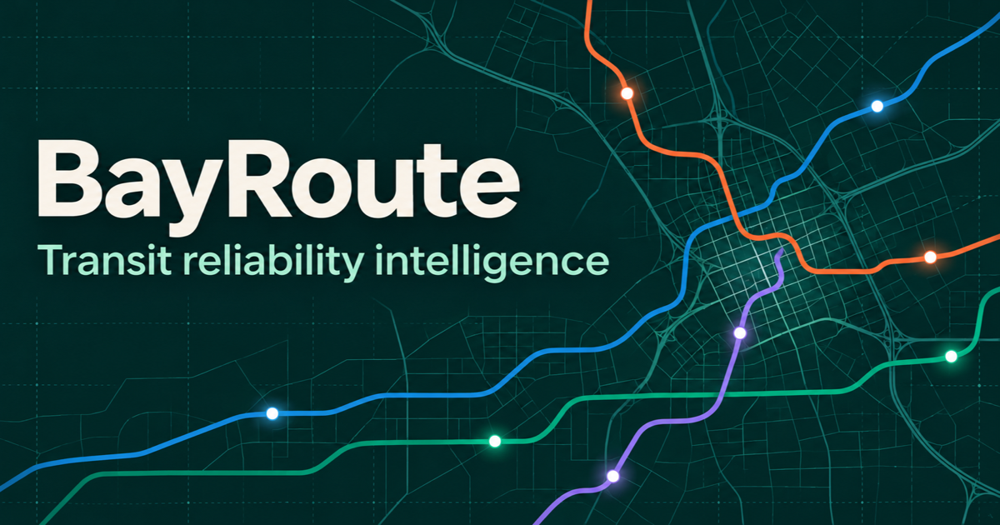
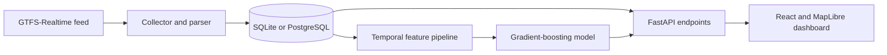

# BayRoute

BayRoute is a full-stack transit reliability and delay-prediction project for the South
Bay. It ingests GTFS-Realtime trip updates, stores operational observations, trains a
chronologically validated gradient-boosting model, and presents live vehicles, route
reliability, and interactive forecasts in a responsive map dashboard.

The repository runs without credentials using deterministic demo data. Live ingestion is
optional and uses a user-supplied GTFS-Realtime Trip Updates endpoint.

## Live Demo

- [Web dashboard](https://bayroute-demo.onrender.com)
- [API documentation](https://bayroute-api.onrender.com/docs)

The free Render demo automatically seeds its SQLite database and trains the included
delay model, so the dashboard, reliability metrics, and prediction workflow are usable
without credentials.



## What is included

- FastAPI service with typed endpoints and OpenAPI documentation
- SQLAlchemy persistence supporting SQLite and PostgreSQL
- Idempotent GTFS-Realtime Trip Updates parser and collector
- Deterministic 28-day demo dataset for zero-config development
- Temporal feature pipeline with chronological train/test separation
- Histogram gradient-boosting model and historical-median baseline
- React dashboard with MapLibre and OpenStreetMap tiles
- Native SwiftUI iPhone app with MapKit, offline fallback, and live API configuration
- Interactive delay forecast form with API and offline-demo modes
- Docker Compose stack for the web app, API, PostgreSQL, and optional collector
- Backend tests, rendered-page tests, linting, coverage, and GitHub Actions CI

## Architecture



The collector produces a stable source-event key from the feed timestamp, entity, stop,
and stop sequence. Replaying the same feed therefore skips existing observations instead
of duplicating them.

## Quick start

Requirements: Python 3.11 or newer and Node.js 22 or newer.

```bash
python3 -m venv .venv
source .venv/bin/activate
python -m pip install -e './backend[dev]'
npm install
```

Start the API in one terminal:

```bash
source .venv/bin/activate
uvicorn bayroute.main:app --app-dir backend --reload --port 8000
```

Start the dashboard in another terminal:

```bash
NEXT_PUBLIC_BAYROUTE_API_URL=http://localhost:8000 npm run dev
```

Open `http://localhost:3000`. API documentation is available at
`http://localhost:8000/docs`.

If `NEXT_PUBLIC_BAYROUTE_API_URL` is omitted, the dashboard uses `public/demo.json`. The
API also seeds a deterministic demo database when `AUTO_SEED_DEMO=true`.

## iOS app

Open `ios/BayRoute/BayRoute.xcodeproj` in Xcode 16 or newer and run the `BayRoute`
scheme on an iPhone or iOS Simulator. The app works immediately with a bundled offline
snapshot and provides four native tabs:

- A MapKit network map with vehicle positions and operational alerts
- A 28-day route reliability comparison
- An interactive arrival-delay forecast
- Settings for switching between demo mode and a live FastAPI deployment

Enter `http://localhost:8000` in the app's Settings tab when the API is running on the
same Mac as the Simulator. See `ios/BayRoute/README.md` for physical-device and hosted
API instructions.

## Docker

```bash
docker compose up --build
```

This starts PostgreSQL, the API, and the dashboard. Data and trained artifacts are stored
in named Docker volumes.

## Live GTFS-Realtime collection

511 SF Bay publishes static GTFS and regional GTFS-Realtime data. Review the official
[511 Transit Data documentation](https://511.org/open-data/transit), obtain a token if the
selected endpoint requires one, and copy the Trip Updates endpoint into `.env`.

```bash
cp .env.example .env
```

Set:

```text
GTFS_RT_TRIP_UPDATES_URL=https://your-trip-updates-endpoint?api_key={api_key}
TRANSIT_511_API_KEY=your-token
AUTO_SEED_DEMO=false
COLLECTOR_KEY=replace-with-a-long-random-secret
```

The collector replaces the literal `{api_key}` in the configured URL. Run a single pull:

```bash
source .venv/bin/activate
bayroute ingest-once
```

Or poll once per minute:

```bash
bayroute collect --interval 60
```

With Docker, enable the optional collector profile:

```bash
docker compose --profile live up --build
```

Trip Updates feeds usually contain delay and stop information but not vehicle coordinates.
The included live map therefore uses coordinates from demo observations unless a separate
Vehicle Positions adapter is added. The parser deliberately does not invent coordinates.

## Model design

Inputs:

- Route and stop identifiers
- Cyclical hour and weekday features
- Peak-period indicator
- Current trip delay
- Previous-stop delay
- Scheduled headway

The dataset is sorted by capture time and split 80/20, so every test observation occurs
after the training observations. The API reports:

- Mean absolute error
- Historical-median baseline MAE
- Improvement over baseline
- Share of predictions within two minutes
- 90th-percentile absolute residual, used as a practical error band

The bundled numbers come from synthetic demo observations and must not be presented as
real VTA performance. Collect and label real observations before using model results in a
résumé or portfolio claim.

Train and save an artifact:

```bash
source .venv/bin/activate
bayroute train
```

## API endpoints

| Method | Endpoint | Purpose |
| --- | --- | --- |
| GET | `/api/health` | Service and model readiness |
| GET | `/api/overview` | Network-level metrics and alerts |
| GET | `/api/routes` | Available routes |
| GET | `/api/stops` | Available stops |
| GET | `/api/live` | Latest unique vehicle positions |
| GET | `/api/reliability` | Route reliability rankings |
| GET | `/api/model/metrics` | Temporal holdout metrics |
| POST | `/api/predict` | Delay forecast with an error band |
| POST | `/api/ingest/gtfs` | Protected one-shot feed collection |

The ingestion endpoint requires the configured value in the `X-Collector-Key` request
header. It returns `503` when no collector key is configured instead of exposing an
unprotected network-fetch endpoint.

## Verification

Backend:

```bash
source .venv/bin/activate
ruff check backend
ruff format backend --check
pytest backend --cov=backend/bayroute --cov-report=term-missing
```

Frontend:

```bash
npm run lint
npm test
```

## Suggested next improvements

- Add a GTFS-Realtime Vehicle Positions adapter and join positions to trips.
- Replace the default coordinates with authoritative static-GTFS stop imports.
- Add Alembic migrations before long-lived production deployment.
- Retrain on a schedule and compare challenger models before promotion.
- Add weather and service-alert features only after testing their incremental value.

## License

MIT
